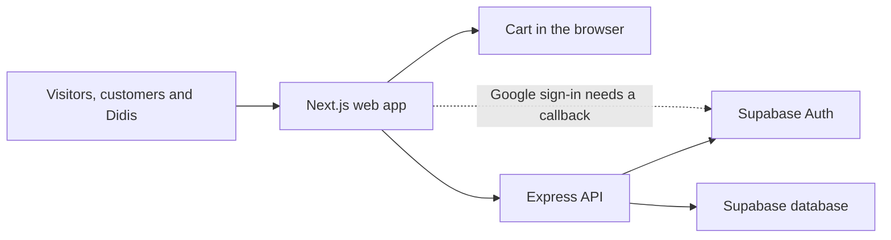
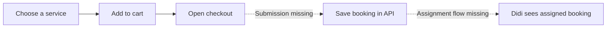

# Project graph

- **Web** (`apps/web`) contains pages, navigation, account forms, the cart, and checkout. The service menu currently reads a local catalog.
- **API** (`apps/api`) handles account requests, service and provider data, and booking endpoints.
- **Supabase** manages identities and stores application data such as user roles, provider services, and bookings.
- **Mobile** (`apps/mobile`) is a separate workspace.

The solid arrows show connected steps. The dotted arrows show gaps in the intended journey.
